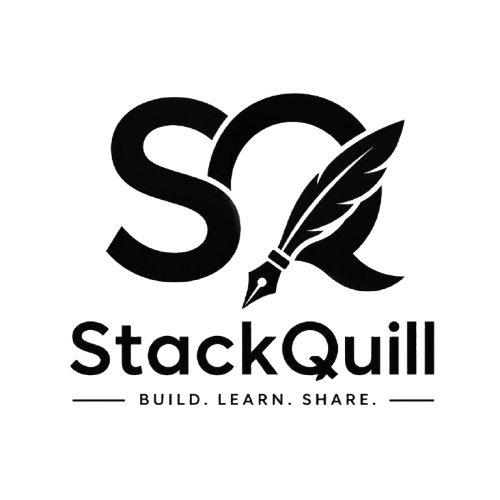

  <picture>
    <source
      media="(prefers-color-scheme: dark)"
      srcset="public/logo/stackquill-logo-light.png"
    />
    <source
      media="(prefers-color-scheme: light)"
      srcset="public/logo/stackquill-logo-dark.png"
    />
    
  </picture>

<h1 align="center">Stackquill</h1>

  A modern blogging platform for developers to publish,
  organize, and share technical knowledge.

**Stackquill is a full-stack blogging platform built with Next.js, TypeScript, Prisma, and PostgreSQL. It provides a clean reading experience, structured content organization, SEO metadata, and content management capabilities.**

## Features

- **Blog Publishing** — Create, edit, and publish technical articles.
- **Content Organization** — Organize articles using categories.
- **SEO Metadata** — Support for page metadata and Open Graph metadata.
- **Responsive Design** — Access content across desktop and mobile devices.
- **Content Management** — Manage articles and categories through an administrative interface.
- **Publishing Workflow** — Support for draft, published, and archived articles.
- **Site Configuration** — Manage website settings and configurable content.
- **Contact Management** — Receive and manage messages submitted through the website.

## Tech Stack

| Technology | Purpose |
|---|---|
| Next.js | Full-stack web framework |
| React | User interface |
| TypeScript | Type-safe development |
| Prisma ORM | Database access and schema management |
| PostgreSQL | Relational database |

## Project Goals

Stackquill aims to provide a practical, maintainable platform for publishing technical articles while exploring modern full-stack web development, database management, content workflows, and search engine optimization.

## Author

**Dainy Jose**

- GitHub: [@dainyjose](https://github.com/dainyjose)
- Portfolio: [dainyjose.github.io/my-portfolio](https://dainyjose.github.io/my-portfolio)

---

Built to make sharing technical knowledge simpler.
