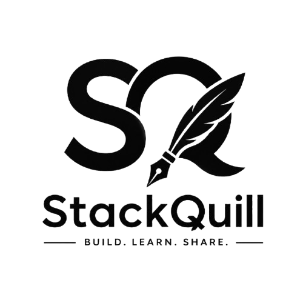
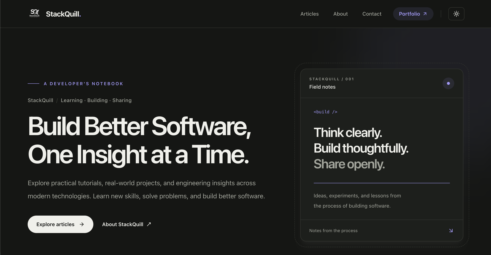

<p align="center">
  <picture>
    <source
      media="(prefers-color-scheme: dark)"
      srcset="./public/logo/stackquill-logo-light.png"
    />
    <source
      media="(prefers-color-scheme: light)"
      srcset="./public/logo/stackquill-logo-dark.png"
    />
    
  </picture>
</p>

<h1 align="center">StackQuill</h1>

<p align="center">
  <strong>Learning, Building, Sharing.</strong>
</p>

<p align="center">
  A modern blogging platform for developers to publish,
  organize, and share technical knowledge.
</p>

<p align="center">
  <a href="https://stackquill-web.vercel.app/">Live Demo</a>
  &nbsp;·&nbsp;
  <a href="https://github.com/dainyjose/stackquill-web">Repository</a>
</p>

---

StackQuill is a full-stack blogging platform built with Next.js, React, TypeScript, Prisma, and PostgreSQL.

It provides a clean, editorial reading experience alongside content management tools, structured article organization, SEO support, and configurable website content.

## Preview

<p align="center">
  
</p>

## Features

- **Blog Publishing** — Create, edit, manage, and publish technical articles.
- **Content Organization** — Organize articles using categories and topics.
- **Editorial Reading Experience** — Clean layouts designed for comfortable reading.
- **SEO Optimization** — Metadata, Open Graph support, and structured content.
- **Responsive Design** — Optimized layouts for desktop, tablet, and mobile.
- **Content Management** — Administrative interface for managing articles and categories.
- **Publishing Workflow** — Manage draft, published, and archived content.
- **Site Configuration** — Customize website content and configuration through the admin panel.
- **Contact Management** — Receive and manage messages submitted through the contact form.
- **Analytics** — Track article engagement and page views.

## Tech Stack

| Technology   | Purpose                               |
| ------------ | ------------------------------------- |
| Next.js      | Full-stack web framework              |
| React        | User interface                        |
| TypeScript   | Type-safe development                 |
| Tailwind CSS | Styling and responsive layouts        |
| Prisma ORM   | Database access and schema management |
| PostgreSQL   | Relational database                   |

## Project Structure

```text
stackquill-web/
├── prisma/             # Database schema and migrations
├── public/             # Static assets and images
├── src/
│   ├── actions/        # Server actions
│   ├── app/            # Next.js App Router pages
│   ├── components/     # Reusable UI components
│   ├── lib/            # Utilities and shared logic
│   └── ...
├── package.json
└── README.md
```

## Getting Started

### Prerequisites

- Node.js
- npm
- PostgreSQL database

### Installation

1. Clone the repository:

```bash
git clone https://github.com/dainyjose/stackquill-web.git
cd stackquill-web
```

2. Install dependencies:

```bash
npm install
```

3. Configure environment variables.

Create a `.env` file in the project root and add the environment variables required by the application.

```env
DATABASE_URL="your_postgresql_connection_string"
```

Add any additional environment variables required by your local configuration.

4. Generate the Prisma client:

```bash
npx prisma generate
```

5. Start the development server:

```bash
npm run dev
```

6. Open [http://localhost:3000](http://localhost:3000).

## Project Goals

StackQuill is a practical project exploring modern full-stack web development, database management, content publishing workflows, responsive interface design, and search engine optimization.

It also serves as a place to document development experiences, technical discoveries, and lessons learned along the way.

## Author

**Dainy Jose**

- GitHub: [@dainyjose](https://github.com/dainyjose)
- Portfolio: [dainyjose.github.io/my-portfolio](https://dainyjose.github.io/my-portfolio)
- Blog: [StackQuill](https://stackquill-web.vercel.app/)

---

<p align="center">
  Built with curiosity and a passion for sharing knowledge.
</p>
